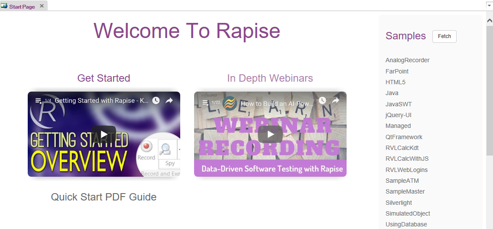

# Start Page

## Purpose

The Start Page is intended to be a convenient entry point for Rapise beginners.

The Start Page provides:

1.  A search box for the documentation, with an **Ask AI** button next to it, on the **Getting Started** tab (Rapise 9.2 and later).
2.  Links to tutorials and webinars.
3.  Links to sample tests, displaying a list of available Rapise samples. Some samples are shipped with Rapise while others are provided from the online public repository.
    *   The **Fetch Samples** button is used to download and update additional samples from the online public repository.

## Searching the Documentation

!!! note "Added in Rapise 9.2"
    The documentation search requires Rapise 9.2 or later.

On the **Getting Started** tab, type in the search box to find a section of the documentation. The results appear as you type: each shows the title of the section, where it is in the documentation, and a short excerpt. Select a result to open it on [rapisedoc.inflectra.com](https://rapisedoc.inflectra.com/).

*   Use the **Up** and **Down** arrow keys to move through the results, **Enter** to open the selected result (or the first one), and **Esc** to close the list.
*   The search is a keyword search and does not use AI. It works without an AI provider and without an internet connection, using the copy of the documentation index that is installed with Rapise. Rapise checks for a newer copy when you first search.

## Chatting with the AI Agent

!!! note "Added in Rapise 9.2"
    The **Ask Agent** box requires Rapise 9.2 or later.

On the **This framework** tab, a box at the top opens the [MCP Agent](../AI/agentic_mcp.md) chat in the AI Panel. The agent can work with the framework through the Rapise MCP server, and with your Spira project through the Spira MCP server. The placeholder text of the box says which of them are available. Type a request, for example *run the smoke tests and report the failures*, and press **Enter** or **Ask Agent**. With an empty box the button just opens the chat.

The box is shown when the Rapise MCP server is enabled (see below) or when Rapise has a Spira connection (**Settings > SpiraTest**) and the Spira MCP server is not switched off. Like **Ask AI**, it needs an AI provider and explains what to set up when there is none.

## Ask AI

!!! note "Added in Rapise 9.2"
    The **Ask AI** button requires Rapise 9.2 or later.

The **Ask AI** button opens the Rapise Help chat in the [AI Panel](../AI/agentic_mcp.md) with the text of the search box as the first question. The Help chat answers from the documentation: it searches and reads the relevant sections and links to them. Press **Ctrl+Enter** in the search box to do the same from the keyboard.

**Ask AI** needs:

*   The [MCP server](../AI/agentic_mcp.md) enabled: set **MCP Server Port** in **Settings > Global** (the usual value is 8275) and restart Rapise. The button is not shown when the MCP server is off.
*   An AI provider. Without one, **Ask AI** explains what to set up instead of opening the chat. You can use [Inflectra.ai](../AI/ai_dashboard.md#inflectraai), which needs no keys of your own, or your own provider (Amazon Bedrock, Azure, OpenAI or Google) with your own keys. Both are configured in the [AI Dashboard settings](../AI/ai_dashboard.md#settings).

## How to Open

The **Start Page** opens automatically with Rapise. This behavior can be modified in the [Options](options_dialog.md) dialog using the **ShowStartPageOnStartup** setting.