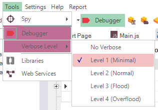

# Verbose Level

## Purpose

The **Verbose Level** affects the amount of information written to the [Output View](output_view.md).

## Usage

The **Verbose Level** is set via the menu `Tools > Verbose Level > ...`:

| Menu item | `g_verboseLevel` |
| --------- | ---------------- |
| No Verbose | 0 |
| Level 1 (Minimal) | 1 (default) |
| Level 2 (Normal) | 2 |
| Level 3 (Flood) | 3 |
| Level 4 (Overflood) | 4 |

The level is kept in the global variable `g_verboseLevel`. It can also be set on the command line, for example `-eval:g_verboseLevel=3`.

## See Also

- [Internal Debugger](internal_debugger.md)
- [Debugger Toolbar](menu_and_toolbars.md)